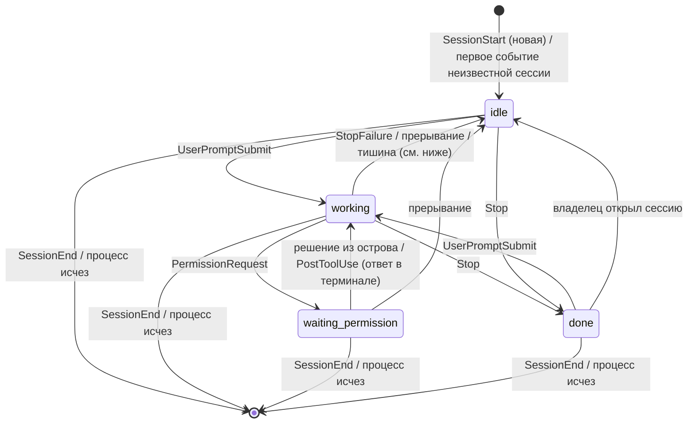
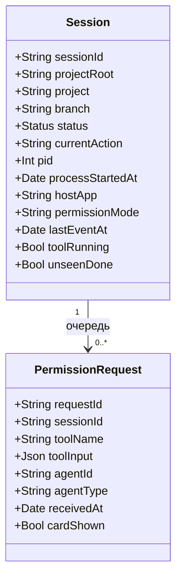

# topbar — спека MVP

Дата: 2026-11-03 (правки после ревью свежим контекстом и после опыта с хуками: 2026-11-04)
Статус: утверждена (2026-11-04)
Заказчик: свой продукт (сначала личный инструмент для одного MacBook; возможный релиз друзьям — позже)

## Цель

Нативное macOS-приложение, превращающее вырез MacBook в «остров» со статусом сессий Claude Code.
Сессий обычно 3–5 одновременно, работаю в Ghostty и в терминале VS Code. Остров должен
показывать, что делает каждая сессия, давать разрешить или отклонить запрос прямо из выреза и
не отвлекать, когда я и так смотрю на нужную сессию.
Поймём, что решили, когда неделю подряд не нужно переключаться по окнам, чтобы узнать, кто работает,
кто ждёт и кто закончил, и когда разрешения отрабатываются из острова.

## Роли

- Владелец (он же единственный пользователь) — запускает несколько сессий Claude Code и хочет
  видеть их статус и отвечать на запросы разрешений, не прерывая основную работу.

## Сценарии

1. Владелец работает в другом приложении → в свёрнутом вырезе видит итог по сессиям
   («1 ждёт · 1 работает · 1 готово») и цвет по самому срочному статусу.
2. Владелец раскрывает остров (клик или наведение) → видит список сессий: проект · ветка,
   мелким шрифтом текущее действие, справа статус.
3. Сессия просит разрешение, а владелец на неё не смотрит → остров раскрывается сам с карточкой
   (что просит сессия, «Разрешить» / «Отклонить»); владелец жмёт кнопку → сессия продолжает или получает
   отказ, диалог в терминале закрывается сам.
4. Владелец отвечает в самом терминале (диалог там виден всегда, параллельно с островом) или остров не
   показывал карточку, потому что владелец смотрит на сессию → карточка исчезает, как только запрос
   закрыт; пока он открыт, у сессии статус «ждёт разрешения».
5. Claude закончил ответ → остров коротко мигает и тихо звякает (на каждый ответ), у сессии остаётся
   метка «готово», пока владелец её не откроет. Если владелец смотрит на эту сессию — остров молчит.
6. Владелец кликает по строке сессии → оказывается в нужном окне Ghostty или VS Code
   (в Ghostty точно, в VS Code — до окна проекта). Клик по строке «ждёт разрешения» открывает карточку,
   а переход к сессии доступен с карточки.
7. Сессия закрыта или процесс убит → строка исчезает сама; сессия, где работа оборвана (Esc, ошибка API,
   лимит), не зависает в «работает».
8. Владелец кликает по иконке в строке меню → видит, установлены ли хуки, может установить или удалить их,
   включить запуск при входе и звук, выйти из приложения.

## Границы MVP

- Остров живёт только на встроенном экране с вырезом. Нет выреза (закрыта крышка, работа на внешнем
  мониторе) — остров не показывается; запросы разрешений остаются только в терминале.
- Иконка в строке меню есть **только** как вход в управление приложением (сценарий 8): статус хуков,
  установка/удаление хуков, две настройки, «Выйти». Статус сессий она не показывает и остров не заменяет.
- Только Claude Code. Только живое состояние в памяти, базы данных нет.
- Работает через хуки Claude Code; приложение запускается при входе в систему (переключатель).
- Настроек две: «запускать при входе» и «звук включён».
- Сессии без терминала (`claude -p`, SDK, cron, фоновые субагенты в неинтерактивном режиме) не
  перехватываются: для них отказ по тайм-ауту был бы тихим отказом, а не передачей терминалу.

## Что НЕ делаем

- Быстрые инструменты: таймер, буфер обмена (есть Maccy), календарь, полка для файлов.
- Медиа и системные HUD.
- Другие агенты, кроме Claude Code (Codex, Cursor и т. п.).
- Отправка новых сообщений в сессию из острова.
- Внешний монитор; иконка в меню как показ статуса сессий (разрешён только вход в управление).
- Кнопка «Разрешать всегда» (хотя Claude Code присылает `permission_suggestions`).
- История завершённых сессий и статистика.
- Чтение журналов сессий (`transcript_path`) как источник статуса; поиск сессий, начатых до запуска приложения.
- Группировка и прокрутка списка (рассчитано на 3–5 сессий).
- Распространение: лицензия, нотаризация, автообновление, магазин.

## Стек и архитектура

Swift + SwiftUI + AppKit. Данные идут в одну сторону: Claude Code → мост → ядро → оверлей;
обратно идёт только ответ владельца на разрешение.

- **Мост хуков** — маленькая программа, которую Claude Code запускает по событиям. Читает JSON со
  stdin, передаёт его приложению через локальный сокет и завершается.
- **Ядро** — слушает сокет, хранит в памяти список сессий и автомат статусов, решает «показывать
  карточку или молчать», опрашивает живость процессов.
- **Оверлей** — прозрачное окно без рамки у выреза встроенного экрана. Плюс иконка в строке меню.

### События хуков

Сверено с документацией Claude Code 2026-11-03 (`code.claude.com/docs/en/hooks`), если не помечено
«проверить опытом».

| Событие | Что даёт | Влияние на состояние |
| :- | :- | :- |
| `SessionStart` | `session_id`, `cwd`, `source` (`startup`, `resume`, `clear`, `compact`, `fork`) | создаёт или обновляет запись по `session_id`; `compact` статус не меняет |
| `UserPromptSubmit` | `prompt` | «работает» |
| `PreToolUse` | `tool_name`, `tool_input` | обновляет действие; отмечает «инструмент выполняется» |
| `PermissionRequest` | `tool_name`, `tool_input`, `permission_suggestions`, `agent_id`/`agent_type` (у субагентов), нет `tool_use_id` | «ждёт разрешения»; ответ — `hookSpecificOutput.decision.behavior` = `allow` / `deny`; в режиме разрешений `auto` события нет (проверено) |
| `PostToolUse`, `PostToolUseFailure` | результат инструмента, признак прерывания | снимает «ждёт разрешения» и карточку (приходит сразу после ответа в терминале — проверено); при прерывании — «простаивает» |
| `Notification` | `message`, `notification_type` | в переходах не участвует; `permission_prompt` приходит через ~6 с после запроса (проверено), поэтому опираться на него нельзя |
| `Stop` | `last_assistant_message`, `background_tasks`, `session_crons` | «готова» (срабатывает после каждого ответа; на прерывание Esc/Ctrl+C не приходит) |
| `StopFailure` | ошибка API | «простаивает» с пометкой «ошибка» |
| `SessionEnd` | `reason` | убирает сессию; бюджет всего 1,5 с, мост не должен тормозить |

Общие поля каждого события: `session_id`, `cwd`, `transcript_path`, `hook_event_name`, часто `permission_mode`.
Проверить опытом: что `SessionEnd` приходит при закрытии окна терминала и kill.

### Мост: правила

- **Скорость.** Для всех событий, кроме разрешения: запись в сокет с жёстким тайм-аутом 300 мс, затем выход
  с кодом 0 и пустым выводом. Нет сокета или приложение молчит — то же самое. Зависшее приложение не должно
  подвешивать вызовы инструментов.
- **Подтверждение.** Ядро сразу отвечает «принято» (до 200 мс); отдельно от этого идёт ожидание решения.
- **Разрешение.** Диалог в терминале Claude Code показывает сам, параллельно с хуком (проверено опытом);
  остров — второй, быстрый путь ответа. Мост ждёт решения от ядра и выходит: когда ядро вернуло решение
  владельца (тогда мост печатает ответ `allow` / `deny` и диалог в терминале закрывается сам — проверено),
  либо когда ядро сказало «без решения», либо по закрытию сокета (приложение упало). Крайний срок —
  тайм-аут хука 10 минут, чтобы мост не жил вечно.
- **Хук не прерывается**, когда владелец ответил в терминале (проверено): мост остаётся живым до своего
  выхода, поэтому карточку снимает ядро по событию `PostToolUse` / `PostToolUseFailure` / `Stop` /
  `SessionEnd`, а не по завершению моста; ядро после этого говорит мосту «без решения».
- **Когда карточку не показываем** (нет экрана с вырезом, сон, владелец смотрит на сессию, инструмент из списка
  исключений) — ядро сразу отвечает мосту «без решения»: терминальный диалог от этого не страдает.
- **Исключения.** Не перехватываем `AskUserQuestion` и `ExitPlanMode`: кнопки «разрешить / отклонить»
  для них бессмысленны. Сессии без терминала тоже не перехватываем.
- **Идентификатор запроса** генерирует мост (в хуке его нет).
- **Процесс сессии.** Мост поднимается по дереву процессов от себя до процесса `claude` и передаёт его
  pid и время старта (защита от переиспользованного pid). Корень проекта — из `CLAUDE_PROJECT_DIR`.
- **Сокет.** Каталог в Application Support с правами только для владельца, проверка владельца подключившегося
  процесса. Мост лежит по стабильному пути; смена пути = переустановка хуков.
- **Установка хуков.** Кнопка в меню показывает, что допишется в `~/.claude/settings.json`, вносит записи
  с узнаваемой меткой и умеет убрать их одним действием. Копий файла рядом не кладёт.

## Ядро сессий

### Автомат статусов

Статусы: `idle` (простаивает), `working` (работает), `waiting_permission` (ждёт разрешения),
`done` (готова). Показана карточка или нет — вопрос отображения, а не статуса: диалог в терминале
открыт в любом случае.

- **Очередь.** Сессия остаётся в «ждёт разрешения», пока в её очереди есть хотя бы один запрос;
  ответ на первый запрос не переводит её в «работает», если второй ещё не закрыт.
- **Тишина.** `working` → `idle`, если событий нет 10 минут **и** нет незавершённого инструмента
  (длинная команда сама по себе не повод). Значение подбираем опытом.
- **Начало сессии** — upsert по `session_id` с дедупликацией по pid. `/clear` и `/resume` дают
  `SessionEnd`, затем `SessionStart`: порядок доставки может нарушиться, поэтому запись объединяется
  по паре (pid, время старта).
- **«Владелец открыл сессию»** — клик по строке или выход её окна на передний план (зависит от механизма
  «смотрит», см. открытые вопросы).
- **Живость.** Опрос процессов раз в 10 с; сразу после пробуждения из сна.

### Очередь запросов

- Карточки показываются по одной, в порядке прихода; на карточке виден счётчик очереди.
- Карточка и ответ привязаны к запросу (идентификатор моста). Ответ владельца, пришедший уже после того,
  как запрос закрыт (ответил в терминале), ядро отбрасывает и показывает «уже обработано».
- Лимита времени у карточки нет: она живёт, пока запрос открыт (до `PostToolUse`, `Stop` или `SessionEnd`).

### Приоритет и сводка

| Статус | Цвет | Текст в сводке | Звук |
| :- | :- | :- | :- |
| `waiting_permission` | жёлтый, мигает | «N ждёт» | показ карточки без звука; раскрытие сразу, если вы не смотрите на сессию |
| `done` (не просмотрена) | зелёный | «N готово» | тихий звук при переходе в `done` |
| `working` | синий | «N работает» | нет |
| `idle` | серый | не показывается в сводке, строка есть в списке | нет |

Цвет острова — по самому срочному статусу по таблице сверху вниз. Сводка: нули опускаются.
Звук — на каждый ответ Claude (решение владельца), включая вопросы Claude; выключается настройкой. Если
будет раздражать — вводим порог по длительности работы.

### Подпись и идентичность

- Проект — из `CLAUDE_PROJECT_DIR` (корень, где началась сессия), а не из текущей папки.
- Ветка — из `.git/HEAD` на `UserPromptSubmit` и `Stop`; worktree (`.git` — файл), detached HEAD или каталог без git — только проект.
- Две сессии с одинаковой подписью различаются суффиксом («#2»).
- У сессии есть `hostApp` (Ghostty или VS Code); если окно найти не удалось, строка помечается
  «нет окна» и по клику ничего не открывает.

## Оверлей и меню

- Нет сессий — остров не виден (вырез обычный). Сессий нет также, пока приложение не получило событий
  после запуска: список после перезапуска пуст, пока сессии не пришлют событие.
- Свёрнут — итог по краям выреза, цвет по приоритету.
- Раскрыт списком — клик или наведение. Строка «ждёт разрешения» по клику открывает карточку.
- Карточка разрешения — инструмент и ввод целиком, если помещаются; иначе ограниченная высота с
  индикатором «показано не всё» и раскрытием. Для субагента — пометка «субагент X». У сессии виден значок
  режима разрешений (в режимах без запросов остров не создаёт ощущения защиты).
- «Сессия готова» — мигание + тихий звук, затем метка до открытия.
- Меню в строке меню — сценарий 8.

Правило «не мешать»: если активное окно — окно этой сессии (Ghostty с её окном или VS Code с
её проектом), остров не раскрывается и не звенит; ответить можно в терминале.

### Системные состояния

- **Сон.** При засыпании все карточки закрываются (запросы остаются в терминале), при пробуждении сразу идёт
  проход проверки живости.
- **Крышка закрыта / внешний монитор.** Остров скрывается, карточки закрываются, запросы остаются в
  терминале. Остров снова появляется на встроенном экране.
- **Падение или перезапуск приложения.** Мост видит закрытие сокета и выходит без решения, диалог остаётся в терминале;
  после перезапуска список пуст до новых событий. Диагностика — в меню («мост не отвечает»).
- **Хуки не установлены** — в меню статус «хуки не установлены» и кнопка установки; остров ничего не покажет.
- **Полноэкранные окна и Spaces** — правила уровня окна подбираем опытом (открытый вопрос).

## Модуль: Переход к сессии

- Ghostty: по клику поднимается нужное окно (точность — окно). Механизм (AppleScript или Accessibility) выбираем опытом.
- VS Code: по клику открывается окно проекта (`CLAUDE_PROJECT_DIR`); точную вкладку терминала не гарантируем.
  Сессия, идущая в расширении VS Code, а не в терминале, — отдельный случай, проверить.
- Строка без окна: «нет окна», по клику ничего.

## Доменная модель

База данных не нужна. Сущности живут в памяти:

`Status` = `idle | working | waiting_permission | done`.

## Результаты опыта с хуками (Ghostty, Claude Code 2.1.317, 2026-11-03/04)

Проверено пробным хуком в изолированной папке (глобальные настройки не менялись):

1. Диалог в терминале появляется **сразу**, параллельно с хуком `PermissionRequest`; ответ в терминале
   через ~1 с после запроса сработал, пока хук ещё работал.
2. Хук **не убивается** при ответе в терминале; сразу после ответа приходит `PostToolUse`.
3. Хук, вернувший `allow`, закрывает диалог в терминале сам и инструмент выполняется (`PostToolUse`
   через ~0,1 с после ответа хука).
4. `Notification` с типом `permission_prompt` приходит через ~6 с после запроса — слишком поздно для показа.
5. Процесс хука — прямой потомок процесса `claude`; `CLAUDE_PROJECT_DIR` приходит в окружении, `TERM_PROGRAM`
   (`ghostty`) — тоже, по нему различаем хост.
6. В режиме разрешений `auto` (стоит у владельца по умолчанию) события `PermissionRequest` нет: безопасные
   команды одобряются без вопроса. Карточки будут нечастыми; остров в основном показывает статусы.
7. `SessionEnd` при выходе командой приходит с причиной `prompt_input_exit`.

## Открытые вопросы

Закрываем до утверждения спеки или на этапе плана (отмечено):

1. Как надёжно определить, что «владелец смотрит на сессию» в Ghostty и в терминале VS Code (какое окно
   активно); нужны ли права «Универсальный доступ». — прототипом, этап плана.
2. Приходят ли события хуков из терминала VS Code так же, как из Ghostty; как ведёт себя расширение VS Code,
   и какое значение `TERM_PROGRAM` там. — повторить опыт в терминале VS Code.
3. Приходит ли `SessionEnd` при закрытии окна терминала (крестиком) и при kill. — повторить опыт.
4. Меняется ли `session_id` при `/clear`. — повторить опыт.
5. Что происходит с диалогом, если остров вернул `deny` (текст отказа доходит до Claude). — проверить при
   сборке моста.

Решения владельца, зафиксированные на этом шаге: звук на каждый ответ Claude; иконка в строке меню
возвращена как вход в управление.
