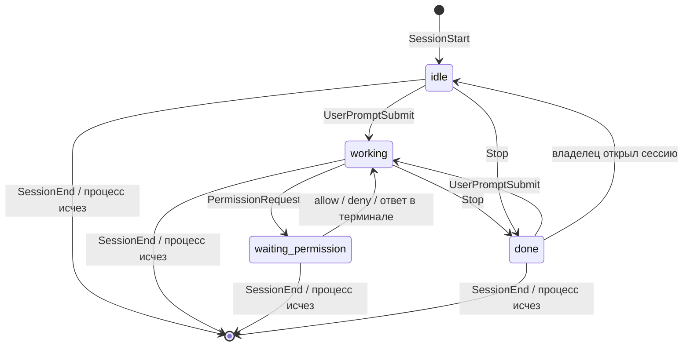
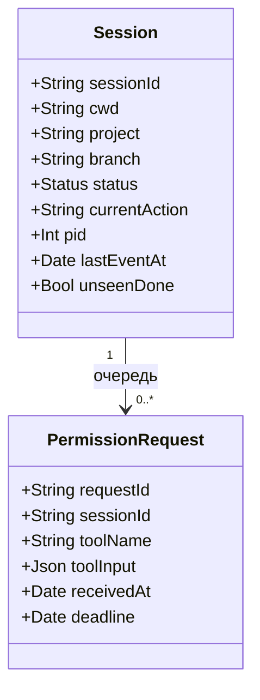

# topbar — спека MVP

Дата: 2026-11-03
Статус: черновик
Заказчик: свой продукт (сначала личный инструмент для одного MacBook; возможный релиз друзьям — позже)

## Цель

Нативное macOS-приложение, превращающее вырез MacBook в «остров» со статусом сессий Claude Code.
Сессий обычно 3–5 одновременно, работаю в Ghostty и в терминале VS Code. Остров должен
показывать, что делает каждая сессия, давать разрешить или отклонить запрос прямо из выреза и
не отвлекать, когда я и так смотрю на нужную сессию.
Поймём, что решили, когда неделю подряд не нужно переключаться по окнам, чтобы узнать, кто работает,
кто ждёт и кто закончил, и когда разрешения отрабатываются из острова.

## Роли

- Владелец (он же единственный пользователь) — запускает несколько сессий Claude Code и хочет
  видеть их статус и отвечать на запросы разрешений, не прерывая основную работу.

## Сценарии

1. Владелец работает в другом приложении → в свёрнутом вырезе видит итог по сессиям
   («2 работают, 1 ждёт») и цвет по самому срочному статусу.
2. Владелец раскрывает остров (клик или наведение) → видит список сессий: проект · ветка,
   мелким шрифтом текущее действие, справа статус.
3. Сессия просит разрешение, а владелец на неё не смотрит → остров раскрывается сам с карточкой
   (что просит сессия, «Разрешить» / «Отклонить», отсчёт 30 с); владелец жмёт кнопку → сессия
   продолжает или получает отказ.
4. Владелец не ответил в острове за 30 с (или приложение не запущено) → запрос показывается в
   самом терминале как обычно; ответ там снимает карточку в острове.
5. Сессия закончила → остров коротко мигает и тихо звякает, у сессии остаётся метка «готово»,
   пока владелец её не откроет. Если владелец смотрит на эту сессию — остров молчит.
6. Владелец кликает по строке сессии → оказывается в нужном окне Ghostty или VS Code
   (в Ghostty точно, в VS Code — до окна проекта).
7. Сессия закрыта или процесс убит без сообщения → строка исчезает сама, а не висит как «работает».

## Границы MVP

- Только встроенный экран MacBook с вырезом; на нём остров живёт. Нет выреза (закрыта крышка,
  работа на внешнем мониторе) — приложение молчит.
- Только Claude Code. Только живое состояние в памяти, базы данных нет.
- Работает через хуки Claude Code; приложение запускается при входе в систему (переключатель).
- Настроек две: «запускать при входе» и «звук включён».

## Что НЕ делаем

- Быстрые инструменты: таймер, буфер обмена (есть Maccy), календарь, полка для файлов.
- Медиа и системные HUD.
- Другие агенты, кроме Claude Code (Codex, Cursor и т. п.).
- Отправка новых сообщений в сессию из острова.
- Внешний монитор, иконка в строке меню как запасной вариант.
- История завершённых сессий и статистика.
- Чтение журналов сессий (`transcript_path`) как источник статуса; поиск сессий, начатых до запуска приложения.
- Группировка и прокрутка списка (рассчитано на 3–5 сессий).
- Распространение: лицензия, нотаризация, автообновление, магазин.

## Стек и архитектура

Swift + SwiftUI + AppKit. Данные идут в одну сторону: Claude Code → мост → ядро → оверлей;
обратно идёт только ответ владельца на разрешение.

- **Мост хуков** — маленькая программа, которую Claude Code запускает по событиям. Читает JSON со
  stdin, передаёт его приложению через локальный сокет и завершается. Для запроса разрешения ждёт
  ответа до 30 с, затем завершается без решения. Если приложение не запущено, завершается сразу
  и молча.
- **Ядро** — слушает сокет, хранит в памяти список сессий и автомат статусов, решает «раскрываться
  или молчать», опрашивает живость процессов.
- **Оверлей** — прозрачное окно без рамки у выреза встроенного экрана.

### События хуков (сверено с документацией Claude Code, 2026-11-03)

| Событие | Что даёт | Влияние на состояние |
| :- | :- | :- |
| `SessionStart` | `session_id`, `cwd`, `source` | создаёт сессию, статус «простаивает» |
| `UserPromptSubmit` | `prompt` | «работает» |
| `PreToolUse` | `tool_name`, `tool_input` | обновляет текущее действие |
| `PermissionRequest` | `tool_name`, `tool_input`, `permission_suggestions` | «ждёт разрешения»; блокирующий, ответ — `hookSpecificOutput.decision.behavior` = `allow` / `deny` |
| `Notification` | `message`, `notification_type` | уточняющий сигнал «сессия ждёт вас» |
| `Stop` | `last_assistant_message` | «готова» |
| `SessionEnd` | — | убирает сессию; бюджет всего 1,5 с, мост не должен тормозить |

Общие поля каждого события: `session_id`, `cwd`, `transcript_path`, `hook_event_name`.
Ветку определяет ядро по `cwd` (git). Идентификатор процесса сессии мост берёт у родительского
процесса: по нему ядро проверяет живость.

Решения по хукам:
- Тайм-аут блокирующего хука `PermissionRequest` задаётся в настройках чуть выше 30 с (35 с);
  мост сам выходит на 30-й секунде без решения, и Claude Code показывает обычный запрос.
- Хук без решения не меняет поток разрешений; `allow` из хука не обходит правила `deny`, это нас устраивает.
- Остальные события не блокируют (мост отдаёт и сразу выходит).

## Состояния оверлея

- Нет сессий — остров не виден.
- Свёрнут — итог по краям выреза, цвет по самому срочному статусу.
- Раскрыт списком — клик или наведение.
- Запрос разрешения — карточка с кнопками и отсчётом 30 с; несколько запросов идут по одному
  в порядке прихода.
- «Сессия готова» — мигание + тихий звук, затем метка до открытия.

Правило «не мешать»: если активное окно — окно этой сессии (Ghostty с её окном или VS Code с
её проектом), остров не раскрывается и не звенит.

## Модуль: Мост хуков

- Отдельный исполняемый файл `topbar-hook`, запускается хуками Claude Code.
- Пишет в сокет одну строку JSON на событие. Не нашёл сокет или приложение не отвечает — выходит
  с кодом 0 и пустым выводом.
- Установка хуков: приложение предлагает кнопку «Установить хуки», показывает, что допишет в
  `~/.claude/settings.json`, и вносит записи с узнаваемой меткой, чтобы их можно было убрать
  одним действием. Копий файла рядом не кладёт.

## Модуль: Ядро сессий

Автомат статусов одной сессии:

- Сессии, начатые до запуска приложения, появляются при их первом событии.
- Живость процессов проверяется периодически; исчезнувшая сессия убирается.
- Подпись строки: `проект · ветка`, вторая строка — текущее действие.

## Модуль: Оверлей

- Окно без рамки, прижатое к вырезу; раскрытие и сворачивание без скачков раскладки.
- Одно окно, три размера: свёрнут, список, карточка разрешения.
- Звук включается/выключается настройкой.

## Модуль: Переход к сессии

- Ghostty: по клику поднимается нужное окно (точность — окно).
- VS Code: по клику открывается окно проекта (`cwd`); точную вкладку терминала не гарантируем.

## Модуль: Настройки

- «Запускать при входе», «звук включён». Хранение — стандартные настройки macOS.

## Доменная модель

База данных не нужна. Единственная сущность живёт в памяти:

`Status` = `idle | working | waiting_permission | done`.

## Открытые вопросы

- Как надёжно определить, что «владелец смотрит на сессию» в Ghostty и в терминале VS Code (какое окно
  активно)? Нужны ли для этого права «Универсальный доступ» — проверить прототипом до плана.
- Приходят ли события хуков из терминала VS Code так же, как из Ghostty (по идее да, настройки общие) — проверить руками.
- Как мост надёжно получает идентификатор процесса сессии (родитель или дальше по цепочке) — проверить.
