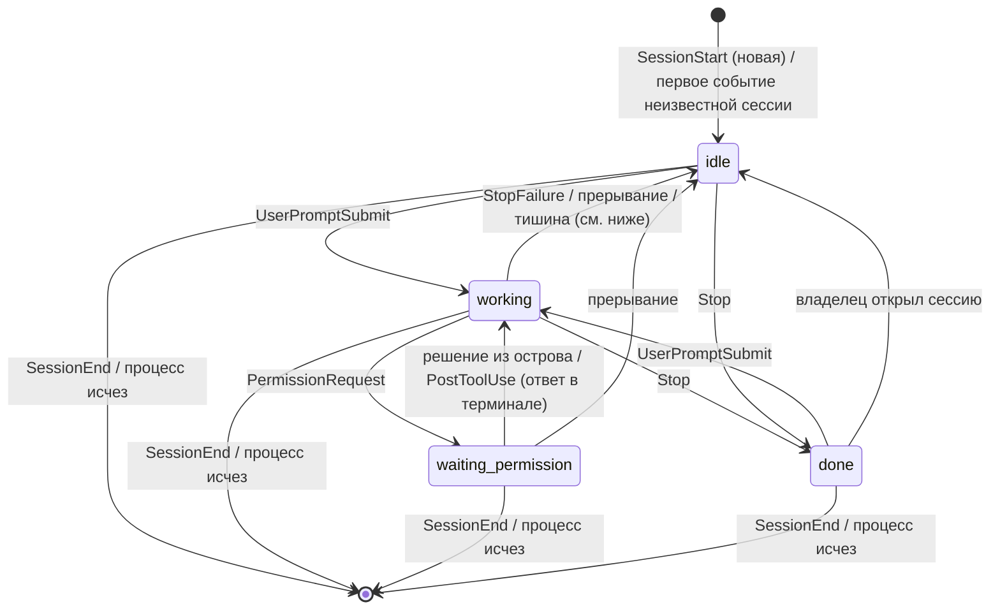
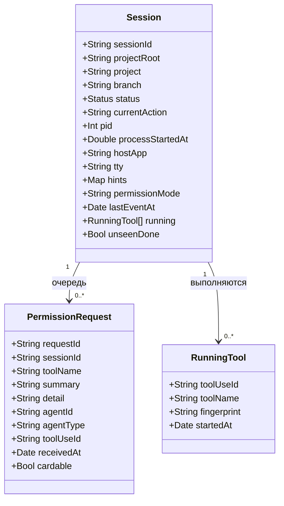

# topbar — спека MVP

Дата: 2026-11-03 (правки после ревью спеки, опыта с хуками и ревью плана: 2026-11-04)
Статус: утверждена (2026-11-04)
Заказчик: свой продукт (сначала личный инструмент для одного MacBook; возможный релиз друзьям — позже)

## Цель

Нативное macOS-приложение, превращающее вырез MacBook в «остров» со статусом сессий Claude Code.
Сессий обычно 3–5 одновременно, работаю в Ghostty и в терминале VS Code. Остров должен
показывать, что делает каждая сессия, давать разрешить или отклонить запрос прямо из выреза и
не отвлекать, когда я и так смотрю на нужную сессию.
Поймём, что решили, когда неделю подряд не нужно переключаться по окнам, чтобы узнать, кто работает,
кто ждёт и кто закончил, и когда разрешения отрабатываются из острова.

## Роли

- Владелец (он же единственный пользователь) — запускает несколько сессий Claude Code и хочет
  видеть их статус и отвечать на запросы разрешений, не прерывая основную работу.

## Сценарии

1. Владелец работает в другом приложении → в свёрнутом вырезе видит итог по сессиям
   («1 ждёт · 1 работает · 1 готово») и цвет по самому срочному статусу.
2. Владелец раскрывает остров (клик или наведение) → видит список сессий: проект · ветка,
   мелким шрифтом текущее действие, справа статус.
3. Сессия просит разрешение, а владелец на неё не смотрит → остров раскрывается сам с карточкой
   (что просит сессия, «Разрешить» / «Отклонить»); владелец жмёт кнопку → сессия продолжает или получает
   отказ, диалог в терминале закрывается сам.
4. Владелец отвечает в самом терминале (диалог там виден всегда, параллельно с островом) или остров не
   показывал карточку, потому что владелец смотрит на сессию → карточка исчезает, как только запрос
   закрыт; пока он открыт, у сессии статус «ждёт разрешения».
5. Claude закончил ответ → остров коротко мигает и тихо звякает (на каждый ответ), у сессии остаётся
   метка «готово», пока владелец её не откроет. Если владелец смотрит на эту сессию — остров молчит.
6. Владелец кликает по строке сессии → оказывается в нужном окне Ghostty или VS Code
   (в Ghostty точно, в VS Code — до окна проекта). Клик по строке «ждёт разрешения» открывает карточку,
   а переход к сессии доступен с карточки.
7. Сессия закрыта или процесс убит → строка исчезает сама; сессия, где работа оборвана (Esc, ошибка API,
   лимит), не зависает в «работает».
8. Владелец кликает по иконке в строке меню → видит, установлены ли хуки, может установить или удалить их,
   включить запуск при входе и звук, выйти из приложения.

## Границы MVP

- Остров живёт только на встроенном экране с вырезом. Нет выреза (закрыта крышка, работа на внешнем
  мониторе) — остров не показывается; запросы разрешений остаются только в терминале.
- Иконка в строке меню есть **только** как вход в управление приложением (сценарий 8): статус хуков,
  установка/удаление хуков, две настройки, «Выйти». Статус сессий она не показывает и остров не заменяет.
- Только Claude Code. Только живое состояние в памяти, базы данных нет.
- Работает через хуки Claude Code; приложение запускается при входе в систему (переключатель).
- Настроек две: «запускать при входе» и «звук включён».
- Сессии без терминала (`claude -p`, SDK, cron, фоновые субагенты в неинтерактивном режиме) не показываются
  вовсе: ни строки в списке, ни звука, ни карточки; запрос остаётся за Claude Code.

## Что НЕ делаем

- Быстрые инструменты: таймер, буфер обмена (есть Maccy), календарь, полка для файлов.
- Системные HUD (громкость, яркость). Плеер добавлен 2026-11-05 — см. «Дополнение».
- Другие агенты, кроме Claude Code (Codex, Cursor и т. п.).
- Отправка новых сообщений в сессию из острова.
- Внешний монитор; иконка в меню как показ статуса сессий (разрешён только вход в управление).
- Кнопка «Разрешать всегда» (хотя Claude Code присылает `permission_suggestions`).
- История завершённых сессий и статистика.
- Чтение журналов сессий (`transcript_path`) как источник статуса; поиск сессий, начатых до запуска приложения.
- Группировка и прокрутка списка (рассчитано на 3–5 сессий).
- Распространение: лицензия, нотаризация (платная подпись Apple), магазин. Раздача друзьям и автообновление добавлены 2026-11-05 — см. «Дополнение: распространение».

## Дополнение 2026-11-05: значки строки меню, вид, плеер

Изменение вне утверждённого MVP (`finea-3-feature`): что меняем, чего не меняем, влияние на схему — схемы нет.

### Остров не накрывает значки

Было: свёрнутый остров делал «уши» шириной 110 пт и накрывал первые значки справа от выреза, включая значок самого
приложения (владелец не мог открыть меню). Стало: правое ухо ограничено свободным местом до первого значка справа от выреза
(окна значков видны через список окон без разрешений). Не помещается подробный вид («● 1 работает») — компактный («● 1»),
затем точки; если и точки не помещаются справа, всё уходит в левое ухо, а правого нет. Места пересчитываются раз в 2 с, пока
остров свёрнут. Раскрытый список и карточка по-прежнему шире выреза — они временные.

### Сворачивание значков одной кнопкой

Делаем: два значка приложения — управляющий («‹»/«›») и разделитель. Всё, что левее разделителя, по клику на управляющий значок
уезжает за край экрана (разделитель на время получает огромную длину), второй клик возвращает; через 10 с развёрнутое сворачивается само.
Значки по умолчанию встают у правого края, рядом с «Пунктом управления» (иначе на Mac с вырезом они попадали бы под вырез и не
были бы видны); пока владелец не передвинул разделитель ⌘-перетаскиванием, клик только объясняет, как расставить. Защита: если
управляющий значок оказался левее разделителя и ушёл за экран, сворачивание сразу отменяется с объяснением. Левый клик — сворачивание,
правый (или с Control) — меню; переключатель «Сворачивать значки меню» в меню.

Не делаем: распознавание чужих значков, панель под строкой меню, перенос чужих значков кодом, доступ «Универсальный доступ» и «Запись
экрана». Причина: на macOS 26 все чужие значки принадлежат «Пункту управления», менеджеры вроде Ice на этом ломаются.

Ограничение: на Mac с вырезом под значки отведено около 660 пт; что не помещается, система тихо не показывает. Сворачивание
освобождает место и возвращает такие значки, но если вместе все значки не помещаются, при разворачивании самые левые снова пропадут.

### Список значков строки меню (по просьбе владельца 2026-11-05)

Левый клик по управляющему значку открывает панель со списком **всех** значков строки меню — и тех, что система не поместила
правее выреза: закреплённые владельцем сверху (в его порядке, кнопка «в самый верх»), остальные справа налево. Источник — дерево
«Универсального доступа» каждого запущенного приложения (`AXExtrasMenuBar`): подпись, положение, имя приложения; значок приложения
берётся у запущенного приложения. Клик по строке нажимает значок (`AXPress`) и закрывает панель. Нужен доступ «Универсальный доступ»
(запрос один раз; панель сама объясняет, зачем). Метки: «под вырезом» (система не показывает) и «спрятан» (за краем экрана).

Ограничения: нажать значок можно, только пока он показан системой и строка меню видна; для «под вырезом» объясняем, что нет места.
Разрешение привязано к подписи приложения: при подписи «ad hoc» после каждой пересборки его нужно включать заново; стабильная подпись
появится вместе с сертификатом разработчика.

### Плеер (по просьбе владельца 2026-11-05)

Делаем: остров показывает то, что играет в системе («Сейчас играет»): браузеры (у владельца Dia и Safari), Музыка, Spotify. Свёрнутый и без
сессий: слева обложка, справа «эквалайзер» (рисует Core Animation, на паузе стоит); есть сессии — сводка сессий важнее, плеер виден в раскрытом
виде. Раскрытый: обложка, название, исполнитель и приложение-источник, ход трека (клик или перетаскивание — перемотка), «назад / пауза-играть /
вперёд». Пауза дольше 45 с — плеер прячется; ничего не играет — тоже. Переключатель «Плеер на острове» в меню.

Как: системный интерфейс MediaRemote закрыт для сторонних приложений (macOS 15.4+), открыт процессам `com.apple.*`. Приложение запускает
системный `/usr/bin/perl`, он загружает нашу маленькую библиотеку (`native/nowplaying.m`, около 150 строк, собирается в `build-app.sh`) и вызывает
из неё функцию: поток состояний строками JSON (обложка — только когда меняется) и одноразовые команды. Своя реализация, чужой код не используется.
Проверено на macOS 26.6 тестовым плеером: состояние, обложка, пауза, играть, вперёд, назад, перемотка.

Неофициальный приём: Apple может закрыть его обновлением. Тогда помощник не заводится три раза подряд (или сообщает ошибку), приложение
перестаёт его перезапускать и плеер просто не показывается; остальное не страдает. Не делаем: громкость, выбор устройства вывода, текст песен,
список источников (показывается один — тот, что система считает текущим).

### Вид («как Notchy»)

Остров растёт из выреза; общая ширина и «уши» подстраиваются под место; в свёрнутом виде — только сводка. Системные HUD, таймеры,
буфер, полка остаются вне объёма.

### Дополнение 2026-11-05: распространение

Приложение раздаётся друзьям и коллегам: у него есть версия, значок, обновления с уведомлением и (по согласию) список установок и отзывы.
Репозиторий `yerbo-t/topbar` на GitHub публичный, лицензия MIT.

- **Подпись кода.** Свой самоподписанный сертификат «topbar release» (создаёт `scripts/setup-signing.sh`, лежит в отдельной связке ключей).
  Apple его не знает: при первом запуске у других людей macOS предупредит, откроется через «Всё равно открыть» (инструкция в образе и в
  README). Смысл сертификата — стабильная подпись: разрешения «Универсальный доступ» и «Автоматизация» не слетают после обновления.
  Резервная копия ключей и сертификата — зашифрованный образ вне репозитория; потеря ключа обновлений значит, что розданные копии не
  примут новые версии.
- **Обновления (Sparkle).** Раз в 6 часов приложение смотрит ленту `appcast.xml` в последнем релизе GitHub. Принудительной установки нет:
  приходит уведомление, в меню появляется «Обновить до …», в списке значков есть крупная кнопка. Кнопка открывает окно Sparkle с
  описанием; «Установить» скачивает и проверяет подпись EdDSA, «Установить и перезапустить» ставит. Окна переносятся на текущий рабочий
  стол даже поверх полноэкранного приложения. В ленте всегда одна, последняя версия. Номер сборки — время сборки (только растёт).
- **Выпуск.** `scripts/release.sh` собирает zip (для обновления), dmg (скачивание) и ленту; `scripts/publish.sh --yes` выкладывает в
  релизы GitHub. Выкладка наружу — отдельное решение владельца.
- **Значок.** Нарисован владельцем: чёрная плашка сверху с кружком и надписью «pBar» (вырез) и ножка снизу, вместе читается «TopBar». В
  светлой теме светлая плитка и чёрные фигуры, в тёмной наоборот. Исходник — `scripts/AppIcon.icon` (Icon Composer; генерирует
  `scripts/tools/make-icon.swift`, буквы — контуры SF Rounded), `scripts/build-app.sh` собирает его `actool`: macOS 26 сам меняет вид по
  теме, на старых системах остаётся светлый.
- **Список установок и отзывы.** Служба `server/` на `https://topbar.finea.kz` (по умолчанию в `scripts/release.sh`; за Cloudflare и
  Coolify `TRUSTED_PROXY_HOPS=2`; адрес вшивается `TOPBAR_SERVER_URL`, без него в сборке нет ни вопроса о согласии, ни
  отправки). Ссылка для людей на скачивание — `https://topbar.finea.kz/download`. При первом запуске окно перечисляет, что уйдёт: имя (если ввели), модель Mac и процессор, память, версии macOS и topbar, язык,
  случайный номер установки; прямо сказано, что сервер видит IP. Запись раз в сутки и после обновления; отказаться и посмотреть
  отправляемое можно в меню. «Написать отзыв…» отправляет только введённое человеком. Ссылка `/download` службы записывает IP и браузер и
  ведёт на последний релиз; прямые скачивания GitHub считает без адресов (счётчики выводятся на странице автора). Хранится: установки,
  отзывы, последние 20 000 скачиваний; данные человека удаляются по просьбе.
- Не делаем: нотаризацию, сбор данных без согласия, отправку содержимого сессий, установку обновлений без нажатия.

## Стек и архитектура

Swift + SwiftUI + AppKit. Данные идут в одну сторону: Claude Code → мост → ядро → оверлей;
обратно идёт только ответ владельца на разрешение.

- **Мост хуков** — маленькая программа, которую Claude Code запускает по событиям. Читает JSON со
  stdin, передаёт его приложению через локальный сокет и завершается.
- **Ядро** — слушает сокет, хранит в памяти список сессий и автомат статусов, решает «показывать
  карточку или молчать», опрашивает живость процессов.
- **Оверлей** — прозрачное окно без рамки у выреза встроенного экрана. Плюс иконка в строке меню.

### События хуков

Сверено с документацией Claude Code 2026-11-03 (`code.claude.com/docs/en/hooks`), если не помечено
«проверить опытом».

| Событие | Что даёт | Влияние на состояние |
| :- | :- | :- |
| `SessionStart` | `session_id`, `cwd`, `source` (`startup`, `resume`, `clear`, `compact`, `fork`) | создаёт или обновляет запись по `session_id`; `compact` статус не меняет |
| `UserPromptSubmit` | `prompt` | «работает» |
| `PreToolUse` | `tool_name`, `tool_input`, `tool_use_id` | добавляет вызов в список выполняющихся, обновляет действие; закрывает запросы, висящие дольше 3 с (на них уже ответили в терминале) |
| `PermissionRequest` | `tool_name`, `tool_input`, `permission_suggestions`, `agent_id`/`agent_type` (у субагентов), нет `tool_use_id` | «ждёт разрешения»; ответ — `hookSpecificOutput.decision.behavior` = `allow` / `deny`; в режиме разрешений `auto` события нет (проверено) |
| `PostToolUse`, `PostToolUseFailure` | `tool_use_id`, результат, признак прерывания | убирает вызов из выполняющихся; закрывает запрос с тем же `tool_use_id` (приходит после ответа в терминале; на долгой команде — по её окончании); при прерывании — «простаивает» |
| `Notification` | `message`, `notification_type` | в переходах не участвует; `permission_prompt` приходит через ~6 с после запроса (проверено), поэтому опираться на него нельзя |
| `Stop` | `last_assistant_message`, `background_tasks`, `session_crons` | «готова» (срабатывает после каждого ответа; **на прерывание Esc/Ctrl+C не приходит** — по документации) |
| `StopFailure` | ошибка API | «простаивает» с пометкой «ошибка» |
| `SessionEnd` | `reason` | убирает сессию; бюджет всего 1,5 с, мост не должен тормозить |

Общие поля каждого события: `session_id`, `cwd`, `transcript_path`, `hook_event_name`, часто `permission_mode`.
Проверить опытом: что `SessionEnd` приходит при закрытии окна терминала и kill.

### Мост: правила

- **Скорость.** Подключение, запись и ожидание «принято» укладываются в один общий срок 300 мс, затем выход с
  кодом 0 и пустым выводом. Нет сокета, приложение молчит или не читает — то же самое. Зависшее приложение не
  должно подвешивать вызовы инструментов, даже если событие большое.
- **Размер.** Полный `tool_input` уходит ядру только вместе с запросом разрешения (его владелец должен увидеть
  целиком). Остальным событиям остаются лишь `command` и путь файла, обрезанные до 300 символов.
- **Подтверждение.** Ядро сразу отвечает «принято»; отдельно от этого идёт ожидание решения.
- **Разрешение.** Диалог в терминале Claude Code показывает сам, параллельно с хуком (проверено опытом);
  остров — второй, быстрый путь ответа. Мост ждёт решения от ядра и выходит: когда ядро вернуло решение
  владельца (тогда мост печатает ответ `allow` / `deny` и диалог в терминале закрывается сам — проверено),
  либо когда ядро сказало «без решения», либо по закрытию сокета (приложение упало). Крайний срок —
  тайм-аут хука 10 минут, чтобы мост не жил вечно.
- **Хук не прерывается**, когда владелец ответил в терминале (проверено): мост остаётся живым до своего
  выхода, поэтому карточку снимает ядро по событию (`PostToolUse` / `PostToolUseFailure` с тем же
  `tool_use_id`, следующий `PreToolUse` через 3+ с, `UserPromptSubmit`, `Stop`, `SessionEnd`), а не по
  завершению моста; ядро после этого говорит мосту «без решения».
- **Канал держится, пока запрос открыт.** Условие «владелец смотрит на сессию» управляет только тем, раскрывается
  ли остров сам. Запрос остаётся в сессии, и по клику на строку «ждёт» карточку можно открыть и ответить.
  Опыт показал, что терминал хука не ждёт, поэтому держать мост безопасно. «Без решения» ядро отвечает, только
  когда запрос закрыт, карточки закрыты принудительно (сон, крышка, пропал экран с вырезом) или канал мёртв.
- **Исключения.** Вопросы вроде `AskUserQuestion` и `ExitPlanMode` не получают кнопок «разрешить / отклонить»:
  сессия показывается «ждёт», карточки нет. Сессии без терминала игнорируются целиком (см. границы MVP).
- **Мёртвый канал.** Если мост ушёл (хук истёк, процесс убит), карточка закрывается, а сессия остаётся «ждёт»
  до события из терминала; ответ с острова после этого возвращает «не доставлено».
- **Идентификатор запроса** генерирует мост (в хуке его нет).
- **Процесс сессии.** Номер берётся из `CLAUDE_PID` (виден в окружении хука, в документации не описан), иначе
  по дереву процессов до процесса с именем `claude` или `claude.exe`. Родитель «на всякий случай» не берётся:
  это может быть оболочка-посредник. Не нашли — номер 0, и проверка живости для такой сессии не применяется.
  Передаются также время старта процесса, терминальное устройство и признаки окна из окружения
  (`GHOSTTY_*`, `VSCODE_*`, `ITERM_*`, `TERM_SESSION_ID`) — для поиска окна во второй части. Корень проекта — из
  `CLAUDE_PROJECT_DIR`.
- **Сессия без терминала** определяется по `CLAUDE_CODE_SESSION_ATTENDED=0` или `CLAUDE_CODE_ENTRYPOINT=sdk…`
  (недокументированные переменные; проверяются на живых сессиях).
- **Сокет.** Каталог в Application Support с правами только для владельца (проверяются при каждом запуске),
  проверка владельца подключившегося процесса, отказ запускаться, если путь уже слушает другой экземпляр, и
  удаление при остановке только собственного файла. Мост лежит по стабильному пути; смена пути = переустановка
  хуков; меню показывает, если моста по прописанному пути нет.
- **Установка хуков.** Кнопка в меню показывает точную построчную разницу по настоящему файлу
  `~/.claude/settings.json` и предупреждает, если запись **переформатирует** файл (ключи отсортируются, отступы
  станут единообразными). Записи вносятся с узнаваемой меткой и убираются одним действием. Симлинк и права
  файла сохраняются, копий файла рядом не кладётся. Неожиданный вид раздела хуков — отказ без записи.
  Побочный эффект: тайм-аут 600 с у хука разрешений поднимает бюджет `SessionEnd` во всех настройках до 60 с
  (мост выходит за 0,3 с, поэтому на практике это не заметно).

## Ядро сессий

### Автомат статусов

Статусы: `idle` (простаивает), `working` (работает), `waiting_permission` (ждёт разрешения),
`done` (готова). Показана карточка или нет — вопрос отображения, а не статуса: диалог в терминале
открыт в любом случае.

- **Очередь.** Сессия остаётся в «ждёт разрешения», пока в её очереди есть хотя бы один запрос;
  ответ на первый запрос не переводит её в «работает», если второй ещё не закрыт.
- **Выполняющиеся вызовы.** Список `PreToolUse` без пары `PostToolUse` (по `tool_use_id`), а не один флаг:
  быстрый `Read` не снимает признак долгой команды. Запрос разрешения привязывается к вызову по имени
  инструмента и отпечатку ввода (команда или путь), потому что в нём нет `tool_use_id`; завершившийся вызов,
  которому запрос не выдавался (например, одобренный режимом `auto`), чужую карточку не закрывает.
- **Тишина.** `working` → `idle`: нет вызовов и событий нет 10 минут; идут только `Bash`, событий нет 20 с и у
  процесса сессии нет дочерних процессов (команду прервали клавишей Esc — события об этом нет); идут другие
  инструменты и тишина 10 минут.
- **Начало сессии** — upsert по `session_id`. Один процесс — одна сессия: событие новой сессии на том же процессе
  (пара pid + время старта) убирает прежнюю (`/clear`, потерянный `SessionEnd`). Запоздавший `SessionEnd` другого
  процесса (resume) живую запись не убирает; `SessionEnd` неизвестной сессии ничего не делает. Неизвестный
  pid (0) в этих правилах не участвует.
- **«Владелец открыл сессию»** — клик по строке или выход её окна на передний план (зависит от механизма
  «смотрит», см. открытые вопросы).
- **Живость.** Опрос процессов раз в 10 с; сразу после пробуждения из сна.

### Очередь запросов

- Карточки показываются по одной, в порядке прихода; на карточке виден счётчик очереди.
- Карточка и ответ привязаны к запросу (идентификатор моста). Ответ владельца, пришедший уже после того,
  как запрос закрыт (ответил в терминале), ядро отбрасывает и показывает «уже обработано».
- Лимита времени у карточки нет: она живёт, пока запрос открыт (до события, которое его закрывает, см. «Мост: правила»).
- Полный ввод запроса хранится целиком и показывается на карточке (до 4000 символов с пометкой «показано не всё»);
  в списке — одна строка.

### Приоритет и сводка

| Статус | Цвет | Текст в сводке | Звук |
| :- | :- | :- | :- |
| `waiting_permission` | жёлтый, мигает | «N ждёт» | показ карточки без звука; раскрытие сразу, если вы не смотрите на сессию |
| `done` (не просмотрена) | зелёный | «N готово» | тихий звук при переходе в `done` |
| `working` | синий | «N работает» | нет |
| `idle` | серый | не показывается в сводке, строка есть в списке | нет |

Цвет острова — по самому срочному статусу по таблице сверху вниз. Сводка: нули опускаются.
Звук — на каждый ответ Claude (решение владельца), включая вопросы Claude; выключается настройкой. Если
будет раздражать — вводим порог по длительности работы.

### Подпись и идентичность

- Проект — из `CLAUDE_PROJECT_DIR` (корень, где началась сессия), а не из текущей папки.
- Ветка — из `.git/HEAD` на `UserPromptSubmit` и `Stop`; worktree (`.git` — файл), detached HEAD или каталог без git — только проект.
- Две сессии с одинаковой подписью различаются суффиксом («#2»).
- У сессии есть `hostApp` (Ghostty или VS Code); если окно найти не удалось, строка помечается
  «нет окна» и по клику ничего не открывает.

## Оверлей и меню

- Нет сессий — остров не виден (вырез обычный). Сессий нет также, пока приложение не получило событий
  после запуска: список после перезапуска пуст, пока сессии не пришлют событие.
- Свёрнут — итог по краям выреза, цвет по приоритету.
- Раскрыт списком — клик или наведение. Строка «ждёт разрешения» по клику открывает карточку.
- Карточка разрешения — инструмент и ввод целиком, если помещаются; иначе ограниченная высота с
  индикатором «показано не всё» и раскрытием. Для субагента — пометка «субагент X». У сессии виден значок
  режима разрешений (в режимах без запросов остров не создаёт ощущения защиты).
- «Сессия готова» — мигание + тихий звук, затем метка до открытия.
- Меню в строке меню — сценарий 8.

Правило «не мешать»: если активное окно — окно этой сессии (Ghostty с её окном или VS Code с
её проектом), остров не раскрывается и не звенит; ответить можно в терминале.

### Системные состояния

- **Сон.** При засыпании все карточки закрываются (запросы остаются в терминале), при пробуждении сразу идёт
  проход проверки живости.
- **Крышка закрыта / внешний монитор.** Остров скрывается, карточки закрываются, запросы остаются в
  терминале. Остров снова появляется на встроенном экране.
- **Падение или перезапуск приложения.** Мост видит закрытие сокета и выходит без решения, диалог остаётся в терминале;
  после перезапуска список пуст до новых событий. Диагностика — в меню («мост не отвечает»).
- **Хуки не установлены** — в меню статус «хуки не установлены» и кнопка установки; остров ничего не покажет.
- **Полноэкранные окна и Spaces** — правила уровня окна подбираем опытом (открытый вопрос).

## Модуль: Переход к сессии

- Ghostty: по клику поднимается нужное окно (точность — окно). Механизм (AppleScript или Accessibility) выбираем опытом.
- VS Code: по клику открывается окно проекта (`CLAUDE_PROJECT_DIR`); точную вкладку терминала не гарантируем.
  Сессия, идущая в расширении VS Code, а не в терминале, — отдельный случай, проверить.
- Строка без окна: «нет окна», по клику ничего.

## Доменная модель

База данных не нужна. Сущности живут в памяти:

`Status` = `idle | working | waiting_permission | done`.

## Результаты опыта с хуками (Ghostty, Claude Code 2.1.317, 2026-11-03/04)

Проверено пробным хуком в изолированной папке (глобальные настройки не менялись):

1. Диалог в терминале появляется **сразу**, параллельно с хуком `PermissionRequest`; ответ в терминале
   через ~1 с после запроса сработал, пока хук ещё работал.
2. Хук **не убивается** при ответе в терминале; сразу после ответа приходит `PostToolUse`.
3. Хук, вернувший `allow`, закрывает диалог в терминале сам и инструмент выполняется (`PostToolUse`
   через ~0,1 с после ответа хука).
4. `Notification` с типом `permission_prompt` приходит через ~6 с после запроса — слишком поздно для показа.
5. Процесс хука — прямой потомок процесса `claude`; `CLAUDE_PROJECT_DIR` приходит в окружении, `TERM_PROGRAM`
   (`ghostty`) — тоже, по нему различаем хост.
6. В режиме разрешений `auto` (стоит у владельца по умолчанию) события `PermissionRequest` нет: безопасные
   команды одобряются без вопроса. Карточки будут нечастыми; остров в основном показывает статусы.
7. `SessionEnd` при выходе командой приходит с причиной `prompt_input_exit`.

8. Проверка моста и ядра на настоящем Claude Code (автоматически, 2026-11-04): `tool_use_id` приходит в `PreToolUse`
   и `PostToolUse`, в `PermissionRequest` его нет; `CLAUDE_PID` верен; в интерактивной сессии `unattended=false`,
   есть терминал (`ttys002`) и признаки окна Ghostty (`GHOSTTY_SURFACE_ID`, `GHOSTTY_RESOURCES_DIR` и др.); в
   `claude -p` `unattended=true`; цикл «ждёт → работает → готово → строка исчезла» проходит, ответ в терминале
   закрывает запрос по `PostToolUse`.

## Известные ограничения (Claude Code не присылает событий)

- **Esc, пока Claude думает** (инструмента нет): статус «работает» держится до 10 минут тишины.
- **Esc во время команды:** статус уходит в «простаивает» через ~20–30 с (20 с тишины + проверка раз в 10 с).
- **Отказ в терминале:** события нет; запрос закрывается следующим `PreToolUse` (через 3+ с), `UserPromptSubmit`
  или `Stop`. Пока этого нет, остров показывает «ждёт».
- **Разрешение в терминале на долгой команде:** карточка и статус «ждёт» остаются до `PostToolUse`, то есть до
  конца команды.
- В режиме разрешений `auto` запросов почти нет, поэтому в основном работает панель статусов.

## Открытые вопросы

Остаются на практическое использование (корректное поведение закрыто юнит-тестами):

1. Как надёжно определить, что «владелец смотрит на сессию» в Ghostty и в терминале VS Code. Первая версия:
   активное приложение совпадает с хостом сессии (приблизительно, на уровне приложения); точнее — по
   `GHOSTTY_SURFACE_ID` / окну, если это окажется возможным без лишних прав.
2. Приходят ли события из терминала VS Code и из расширения VS Code; значения `TERM_PROGRAM` и признаков окна.
3. Приходит ли `SessionEnd` при закрытии окна терминала крестиком и при `kill -9` (при отсутствии события
   сессию убирает проверка живости не позже чем через 10 с).
4. Меняется ли `session_id` при `/clear` и `/resume` (один процесс — одна сессия, поэтому дубль не возникнет).
5. Что именно приходит после Esc и после отказа в терминале; субагент (`agent_id`, `agent_type`).

Решения владельца, зафиксированные на этом шаге: звук на каждый ответ Claude; иконка в строке меню
возвращена как вход в управление.
